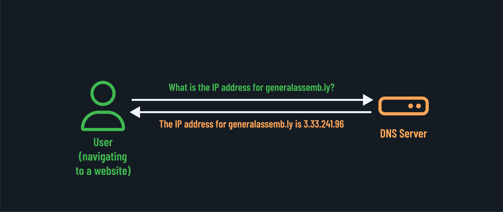
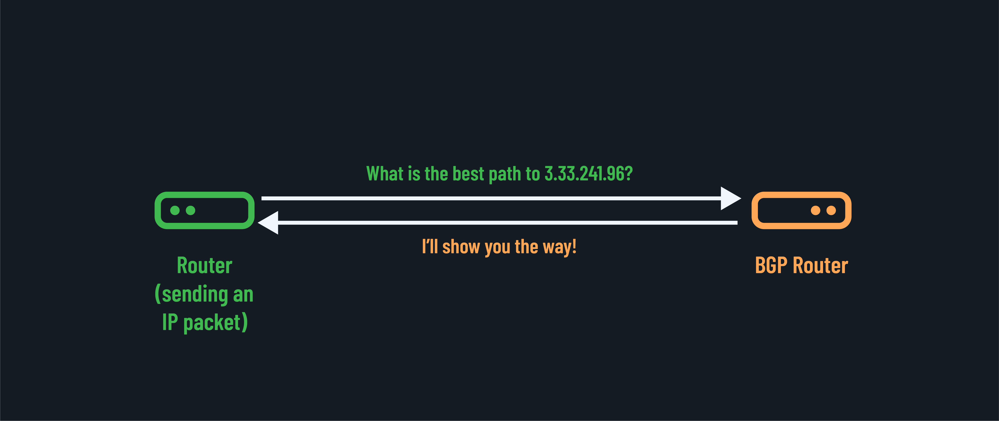

<h1>
  It's Always DNS
  Understanding DNS and BGP
</h1>

**Learning objective:** By the end of this lesson, students will be able to explain how DNS and BGP function as the essential navigation systems of the internet.

## The internet's yellow pages: DNS

The Domain Name System (DNS) serves as the internet's address book, translating human-readable domain names (like `generalassemb.ly`) into machine-readable IP addresses (like `3.33.241.96`). Without DNS, we'd all need to memorize strings of numbers to visit websites. Imagine trying to remember `3.33.241.96`  instead of `generalassemb.ly`!

DNS operates through a hierarchical, distributed database:

- Root servers (13 sets worldwide).
- Top-Level domain servers (`.com`, `.org`, `.net`).
- Authoritative nameservers (specific to domains).
- Recursive resolvers (your ISP's DNS servers).

When you type a URL, your computer initiates a DNS query that cascades through this hierarchy until it finds the correct IP address. This entire process typically occurs in milliseconds!

## The internet's road map: BGP

While DNS helps you find destinations, Border Gateway Protocol (BGP) determines how you get there. BGP is the routing protocol that enables the internet to function as a "network of networks," directing traffic across autonomous systems (AS) — the independent networks operated by different organizations.

BGP routers exchange information about:

- Available network paths.
- Path preferences.
- Policy-based routing decisions.

These routers say, "I know how to reach these networks, and here's my preferred path." Other routers use this information to build their own routing tables. It's a massive, dynamic conversation happening constantly across the globe that determines the path your data takes.

Think of BGP as the GPS navigation system of the internet, but one where the map is constantly being redrawn as networks appear, disappear, and change their connections.
